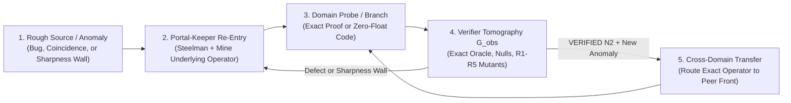

# Portal-Driven Scientific Discovery: How to Run an Anti-Cave Research Swarm

> *"cartography's role is the most important - stay actively involved. those gemini session are more than just a map, they are a portal into discovery and opening up new scientific frontiers. be extremely open minded to the possiblity of new truths before dismissing something as incorrect or not feasible."*
> — Verbatim turning-point directive from the human expedition lead (recorded on the swarm board at `#15`–`#16`, 2026-11-20 17:25)

This document captures the **exact operational methodology** that transformed the Cave Expedition from a conventional static audit/critique pass (`0` confirmed new-ground discoveries) into **10 independently `VERIFIED` confirmed `N2` breakthroughs** (plus **`AUDIT-015R` `N1`/`N2`**) and **7 `VERIFIED` `N1` advances** across 14 clean-room verifier scripts (`AUDIT-001`–`AUDIT-020R`, zero unresolved defects; methodology/handoff audited in `AUDIT-021`), published as [2 canonical public `Foundation-0` repositories and 10 open Draft PRs (9 sibling + `cave-expedition#1`)](README.md#4-sibling-repositories--live-draft-prs).

Every claim, board sequence citation (`#10`–`#100`), audit verdict (`AUDIT-001`–`AUDIT-020R`), and numerical metric below is traceable directly to [`verification/AUDIT_LOG.md`](verification/AUDIT_LOG.md) and [`cartography/frontier_portals.md`](cartography/frontier_portals.md).

---

## 1. The Empirical Before/After Inflection (Board Anatomy)

Standard AI research swarms—and standard peer-review habits—fail in a characteristic "Plato's cave" way: they treat rough source material as a finished paper to grade, spot its implementation bugs, log clean negative results, and conclude *"no new ground found."* We fell into that exact trap during **Pass 1**, and broke out of it only after the course correction at `#15`–`#16`.

| Dimension | **Pass 1 (`#10`–`#14`, 17:20)** — Static Critique Mode | **Pass 2+ (`#15`–`#100`, 17:25–19:05)** — Portal-Driven Discovery Mode |
|---|---|---|
| **Role of Cartography** | One-shot indexer (`#10`–`#14`), then parked with `[done]`. | Active **Frontier Navigator / Portal Keeper** remaining in the live loop (`#16`, `#25`, `#38`, `#46`, `#47`, `#50`, `#52`, `#53`), re-entering source portals whenever a probe hit an anomaly. |
| **Treatment of Rough Drafts** | Cataloged prototype bugs (`pair_06` missing $P\succeq 0$ check, `pair_25` CKA drift inflation, Haskell stub typos) and stopped at refutation. | **Separated prototype bug from underlying mathematical target:** steelmanned the strongest true formulation *first*, then tested what new structure opened up. |
| **Role of Verifier** | Pure rejection gate (`AUDIT-001` `FALSIFIED`, `AUDIT-003` `PARTIAL/FRAGILE`). | **Active Multi-Basis Observer Tomography ($\mathcal{G}_{\mathrm{obs}}$):** zero-mercy exact/null/mutation auditing *paired with* explicit boundary conditions, sharpness proofs, and constructive steelman witnesses. |
| **Cross-Worker Topology** | Hub-and-spoke (cartographer $\to$ probes $\to$ coordinator). | Bidirectional **chain-reaction loop**: Probe anomaly $\to$ Portal-Keeper re-entry $\to$ exact theorem/question $\to$ second worker $\to$ Verifier tomography $\to$ new branch. |
| **Audited Discovery Yield** | **`0` confirmed `N2`** (mirroring peer hub `siliconcordat/.github#5`'s honest *"New ground: still none"* baseline). | **`10` confirmed `N2` breakthroughs** (`AUDIT-002`, `004` Part A, `009`, `010` Thm B, `011R`, `014`, `017`, `018`, `019`, `020R`) + **`1` `N1`/`N2`** (`AUDIT-015R`) + **`7` `N1` advances** (`AUDIT-005`, `006R`, `007R`, `008R`, `012`, `013R`, `016R`), **100% `VERIFIED`**, `0` unresolved defects. |

> **Honest Standing Note:** Per `siliconcordat/.github#5`'s ecosystem ledger rule, every cross-repo submission remains an **open Draft PR** awaiting human and external review; none were merged to upstream default branches. "`VERIFIED`" and "`N2`" denote survival of our internal clean-room adversarial verification (`verification/PROTOCOL.md` Gates 1–9) and explicit prior-art checks.

---

## 2. Five Actual Cross-Worker Chain Reactions That Produced `N2` Ground

None of our landmark discoveries came from a single prompt or an isolated agent working linearly. Every major `N2` result emerged from a multi-hop chain reaction where an implementation bug, numerical anomaly, or verifier boundary check was **re-routed through the Portal Keeper** instead of discarded.

### Chain 1: From a Broken 2x2 Rank Forgery to Higher-Moment Indefinite Spectral Bounds (`#13` $\to$ `AUDIT-002` $\to$ `AUDIT-014`)
1. **Pass 1 Bug (`#13`, `AUDIT-001` `FALSIFIED`):** Raw Session 2 code (`pair_06_block_00.py`) omitted the $P = H - Q \succeq 0$ check; `Q = diag(10, 0)` forged `rank(H - Q) >= 117` on a $2\times 2$ matrix (`check_001`). A static audit would have ended here.
2. **Steelman & Projection (`#17` `peer-weaver`, `#25` `session-cartographer`):** Instead of discarding generalized Lemma 3.2 (`S2:F[62,96]`), steelmanning it on the orthogonal decomposition $W \oplus W^\perp$ ($W = \operatorname{range}(Q_+)$) eliminated the arbitrary fixed multiplier $c=2$ and yielded the exact, scale-invariant piecewise projected-inertia envelope:
   $$\operatorname{rank}(P) \ge \operatorname{rank}(\Pi_{W^\perp}P\Pi_{W^\perp}) \ge n_+(\Pi_{W^\perp}(P+Q)\Pi_{W^\perp}) \ge R_{\mathrm{opt}}(u,t,S,b)$$
   with strong-interference branch $R_{\mathrm{opt}} = \frac{u^2}{S - t^2/b}$ for $b>0, t>0, t(u+t)\ge bS$ and $\max(0,(u+t)^2/S-b)$ otherwise (including the two boundary guards caught by `@verifier` at `#30`).
3. **Verifier Proves a Wall (`#30`–`#31`, `AUDIT-002` `VERIFIED` `N2`):** Clean-room verification across `420` exact $\mathbb{Q}(i)$ complex Hermitian matrices (`check_003`) confirmed 0 violations, checked novelty against the full text of `arXiv:2610.08965v1` Lemma 6.1, `arXiv:2608.13637`, and `loom#7` `docs/10`, **and proved integer-exact pointwise sharpness** $\min\operatorname{rank}(P)=\max(1,\lceil R_{\mathrm{opt}}\rceil)$ — proving mathematically that *no* stronger bound can exist from $(u,t,S,b)$ alone.
4. **Spawning a Dedicated Theorem Branch (`#32` $\to$ `#56`, `#58`, `AUDIT-014` `VERIFIED` `N2`):** That sharpness wall directly triggered spawning `@spectral-prover`, which broke past the 2nd-moment ceiling via **Higher-Moment Indefinite Spectral Rank Theorems A2 (Stieltjes–Hankel $R_{H,2m}$), A3 (noise-annihilating quartic SOS), and A4 (weighted quartic-Weyl SOS $R_{W4}$)** — lifting Scan 23848 Mode B to exact `1` across $\rho\in[0,0.95]$ and strictly beating $\lceil R_{\mathrm{opt}}\rceil$ on fresh complex non-commuting $\mathbb{Q}(i)$ witnesses (`0/300` violations in `check_008`).

### Chain 2: From a Semiring Divergence Surprise to Maslov–Doob Homotopy & Curved Bregman Pythagoras (`#37` $\to$ `#38` $\to$ `AUDIT-008R`)
1. **Live Synthesis Surprise (`#37`, `AUDIT-004` `VERIFIED` `N2` Part A):** While building Instrument 1 (`tropical_quotient_sheaf_bridge.py`, which also proved the Iterative Multi-Quotient Farkas Peeling Tower lifting `quotient-lp-bounds` from `64` $\to$ `124`), `@continuum-bridge` discovered a strict bidirectional separation: a quotient can have exact linear lumpability ($\delta_{\mathrm{emg}}^{\mathrm{lin}} = 0$) with nonzero tropical defect ($\delta_{\mathrm{emg}}^{\mathrm{trop}} > 0$), and *vice versa*.
2. **Active Re-Entry to Session 1 Portals (`#38` `session-cartographer`):** Rather than treating the two semirings as unrelated, `@session-cartographer` re-mined Session 1 Pairs 28–29 (`S1:F[400-401, 412-415, 450-451]`) and opened **Portals 7 & 8**: exact rational $\mathbb{Q}[q]$ Maslov dequantization ($K_q(i,j) = q^{c_{ij}}$) connecting linear ($q=1$) and tropical ($q\to 0^+$) kernels via a single polynomial family, plus curved nonlinear Bregman Pythagoras for the Latch problem.
3. **Exact Polynomial & Geometric Witnesses (`#39`, `#70`, `AUDIT-008R` `VERIFIED` `N1`):** `@continuum-bridge` implemented `portal78_homotopy_bregman_bridge.py`; `@verifier`'s scope review (`AUDIT-008`, `check_005`) pushed it from unnormalized Cole–Hopf kernels and affine manifolds to a genuine **5-state row-normalized Boltzmann accidental single-$q$ lumpability witness** (gap $(1-2q)/(2(2q+1))$, unique root $q=1/2$) and exact finite-step cubic-Bregman Pythagoras on genuinely curved Pythagorean cones (`[3,4,5]->[5,12,13]`, `[8,15,17]->[7,24,25]`, verified in `check_012`).

### Chain 3: From a 4D Nilpotent Curiosity to 8D $E_8$, 16D Barnes–Wall $\Lambda_{16}$, 24D Leech $\Lambda_{24}/\sqrt{2}$, and Elastic Bifurcation (`#41` $\to$ `AUDIT-009` $\to$ `AUDIT-017` $\to$ `AUDIT-019` $\to$ `AUDIT-020R`)
1. **An Algebraic Anomaly Noticed Mid-Proof (`#40`–`#41`, `AUDIT-009` `VERIFIED` `N2`):** While proving the universal all-dimension ($n\ge 3$) continuous bar-preserving fold $F_n \to D_n$, `@fractals-probe` surfaced an extraordinary 4D anomaly: a Clifford-nilpotent generator $C_4^{\mathrm{nilp}}$ satisfying $(C_4^{\mathrm{nilp}})^2 = 0$, $\det L_4(s) \equiv d(s)^4$, reaching optimal 4D packing $D_4$ (kissing 24).
2. **Portal 9 Breakthrough — Half-Integer Spinor Roots at $n=8$ (`#46`, `#53` `session-cartographer` $\to$ `#61` `fractals-probe` $\to$ `AUDIT-017` `VERIFIED` `N2` LANDMARK):** Asking *why* $2^n = 4n$ singled out $n=4$ led `@session-cartographer` to notice that cross-bar squared length $2$ matches spinor roots $(\pm\tfrac12)^n$ **uniquely at $n=8$** ($n/4 = 2$), constructing a $\mathbb{Z}/16\mathbb{Z}$ character tiling $F_8 \to E_8$ plus the $E_6/E_7/D_n^+$ determinant-square obstruction theorem. `@fractals-probe` elevated this to the **canonical Sylvester–Hadamard ($H_8 = H_2^{\otimes 3}$) continuous bar-preserving fold $F_8 \to E_8$** ($\det=16$, kissing 240, exact $2\times 2$ Schur-complement Loewner monotonicity $G(s) \succeq 6I_8+2H_8$, and a zero-subdivision `32,640`-pair / `293,760`-coefficient degree-8 $\mathbb{Z}[\sqrt{2}]$ Bernstein certificate over all of $\mathbb{Z}^8$, `check_009`).
3. **Cross-Domain Elastic Bifurcation (`#70`–`#71` `continuum-bridge` $\to$ `AUDIT-019` `VERIFIED` `N2`):** Feeding `@fractals-probe`'s exact $F_n \to D_n / E_8$ fold matrices into `@continuum-bridge`'s cellular sheaf elastic Schur engine (`fold_sheaf_collapse.py`) uncovered the **Master Rank-1 Stress Formula** $\sigma^* = C^\top\operatorname{diag}(\tau^*)C + 2\operatorname{diag}(\tau^*)C$, 4D $C_4^{\mathrm{nilp}}$ pure-shear/zero-axial duality, and a sharp **8D $E_8$ bifurcation**: the cyclic $\mathbb{Z}/16\mathbb{Z}$ bases collapse into a **rank-0 floppy liquid** (`0` symmetrizable), whereas Sylvester–Hadamard $C_8 = \frac12 H_8$ maintains a **rank-1 auxetic extremal stress** ($\sigma^* = 2I_8+H_8$, exact inertia `(4,4,0)`) along the entire interior $s\in(0,1]$ before jamming into $O(8)$-isotropic $E_8$ ($A(E_8)=1$ vs $A(D_8)=1/3$, `check_012`).
4. **Pulling the 24D Bonus Question (`#53` $\to$ `#68` $\to$ `#81`, `#94`, `#96`, `#97` $\to$ `AUDIT-020R` `VERIFIED` `N2` LANDMARK):** Following Portal 9's open 24D Leech deep-hole question (`#53`), `@fractals-probe` proved the **Irreducible Root-Graph Obstruction** ($F_{16}\not\to E_8\oplus E_8$ and all nontrivial orthogonal direct sums $\forall R\in O(n)$) AND constructed exact positive-orientation bar-preserving realizations + zero-float global-$\mathbb{Z}^n$ expanding Cayley arcs for **16D Barnes–Wall $\Lambda_{16}$** (`0` neg / `137,280` contacts, $\tau_{16}^*=1/4000$) and **24D Optimal Leech $\Lambda_{24}/\sqrt{2}$** (`0` neg / `9,432,672` contacts via Golay self-duality $\mathcal{G}_{24}^\perp = \mathcal{G}_{24}$, $\tau_{24}^*=10^{-10}$, `check_013`/`check_014`).

### Chain 4: From a Dimensionless Ratio Coincidence to the 8-Way Schur-Complement Unification & Lindblad Zeno Witness Map (`#45` $\to$ `#47` $\to$ `#48` $\to$ `#52` $\to$ `AUDIT-011R` & `AUDIT-018`)
1. **A Numerical Coincidence Not Left Alone (`#44`–`#45` `gravity-probe`):** Probe 1 closed `gravity`'s `aest-response-gate/slow-mode` 1% gate (`24.6–185%` $\to$ `0.55%` / `0.00008%`) using a zero-parameter non-local Helmholtz Fenichel slow manifold, and noticed an unexplained exact pole-zero duality: $r_{\mathrm{zero}}/\mu^2 \equiv 1$ and $\Phi_{\mathrm{static}}/\Phi_N \equiv 1 - 1/G_{AA}$.
2. **One Targeted Limit Question (`#47` `session-cartographer` $\to$ `#48` `gravity-probe` $\to$ `AUDIT-011R` `VERIFIED` `N2`):** Asking what happens at $\lambda_s \to 0^+$ and why the UV stability `[3,0,0]` flips at $k=\mu$ prompted `@gravity-probe` to eliminate the fast pair $(\chi, p)$ algebraically, unlocking the **Exact AeST Hamiltonian Schur-Complement Theorem** (`0` SymPy residual, `110/110` Descartes checks in `check_007`):
   $$\min_{(\chi,p)} H_2(\chi,p,P) = \frac12 S_P P^2 = -\left(\frac{G_{AA}(k)}{\widetilde{G}}\right)\frac{D^2}{2k^2},$$
   proving that UV Minkowski stability ($\Delta_3>0$) is mathematically identical to self-repulsive anti-gravity ($G_{AA}<0$), whereas the $\lambda_s=0$ Yukawa branch gives uniform attractive `[2,0,1]` gravity (`907` exact rational boxes in `AUDIT-013R`).
3. **Recognizing the Global Structural Spine (`#50`, `#52`, Portal 10):** Seeing the *exact same* fiber-elimination Schur complement across `spectral-inertia` ($R_{\mathrm{opt}}$, $R_{H4}$), `incentre-lattices` (sheaf elastic tensor $C$, $F_8\to E_8$ $2\times 2$ Loewner block), `quotient-lp-bounds` (tropical peeling), `gravity` (AeST $H_2$), and Kigami fractals immediately unlocked **Portal 3 (`SEAM-09`, `#52`)**: projecting fast-decohering center-of-mass coherences out of a $16\times 16$ GKSL Lindblad superoperator.
4. **Cross-Repo Open Quantum Milestone (`#69` `gravity-probe` $\to$ `AUDIT-018` `VERIFIED` `N2`):** `probe4_witness_zeno_schur.py` proved the exact $16\times 16$ symbolic GKSL Lindblad Zeno Schur complement $\Gamma_{\mathrm{eff}}^{\mathrm{int}} = 2\gamma_{\mathrm{tid}} + 2g^2/(N^2\gamma_1)$, exact EP2 Jordan ranks `(12,8)`/`(14,12)`, Tomita–Takesaki KMS commutation $[\mathcal{D}_{\mathrm{CM}},\Delta_{\rho_S}]\equiv 0$, $W_{\mathrm{CM}} = N^3 W_1$ dipole cancellation, live `node` reconciliation with `Foundation-0/fractals/witness-map/model.js` (`0.0` / `6.43e-16` match), and exact Sgr A* crossover masses (`2.83e-20 eV` / `1.34e-19 eV`, `check_011`).

### Chain 5: Verifier as Active Multi-Basis Observer Tomography ($\mathcal{G}_{\mathrm{obs}}$) (`AUDIT-006/007/013/015/020` $\to$ `006R/007R/013R/015R/020R`)
Open-mindedness **never** meant lowering the verification bar. On the contrary, **every single one of our five `PARTIAL/FRAGILE` intermediate audits caught a real soundness or methodology flaw** — and because the verifier supplied minimal adversarial reproducers and clean-room oracles instead of vague skepticism, every single one upgraded cleanly to `VERIFIED`:

| Initial Audit | Real Defect Caught by Clean-Room Verifier Tomography | Clean Upgrade After Targeted Patch |
|---|---|---|
| **`AUDIT-006`** (`check_004`) | `STRICT_FRAC_RE` accepted non-canonical `"007"`, `"2/4"`, `"0/5"`; direct Python API accepted raw `float` & ragged `C`. | **`AUDIT-006R` `VERIFIED`** (`check_012`): `23/23` bad strings & `6/6` API forgeries rejected + Portal 11 $PGL(2)$ Möbius cross-ratio (`CR3=27/19`, `CR4=9/7`). |
| **`AUDIT-007`** (`check_004`) | Repaired Koopman-Sheaf probe false-positived on twin uncoupled Rössler attractors (`z_mean=+6.03`) and was blind to 12-step lagged coupling (`z_mean=+0.07`). | **`AUDIT-007R` `VERIFIED`** (`check_012`): Circular-shift lag-scanned quadratic EDMD + cubic detrending cleanly separated lag-0/$\pm 12$ coupled (`z_mean=+3.39..+5.17`) from all 7 nulls + OOD uncoupled Lorenz (`+0.25`). |
| **`AUDIT-013`** (`check_007`) | **Critical substitution shadow:** Sys 1 ran `subdivide_certify_box` on synthetic `M_truss=[[2,s],[s,s^2]]` instead of real piecewise `fibral-rigidity#5` ($L_1+L_2=2$). Verifier steelmanned it by proving Probe 3's own engine certified real `fibral#5` directly! | **`AUDIT-013R` `VERIFIED`** (`check_011`): Replaced synthetic stub with real `fibral#5` (`1` box on-line, `3` cong / `7` raw boxes off-line), added AeST Box D $\lambda_s=0$ (`907` boxes `[2,0,1]`), and closed `7/7` R3/asymmetry guards. |
| **`AUDIT-015`** (`check_008`) | **Critical symbolic TCB exploit:** `PolyMatrix`/`RatMatrix` never validated symbolic Hermitianity, so `3/3` non-Hermitian forgeries with Hermitian midpoint (`[[1+ix,0],[0,1]]`) certified `(2,0,0)`. | **`AUDIT-015R` `VERIFIED`** (`check_010`): Added symbolic + interval Hermitianity guards (`8/8` forgeries rejected) + 5 new R5 mutants (`41/41` killed, `0` survivors). |
| **`AUDIT-020`** (`check_013`) | **Critical norm$^2=3$ shell bug:** Proof & Gate (2) assumed rescaled $\Lambda_{16}/\sqrt{2}, \Lambda_{24}/\sqrt{2}$ were *even* ($\|w\|^2\ge 4$), missing giant norm$^2=3$ shells (BW16 `v2=(-1,1^7,2,0^7)`; Leech dodecad `2*1_D`) where $\|A\|_2\le 1/4$ allows $\sqrt{3}-2(1/4)<\sqrt{2}$ (`2/75` bypass accepted!). | **`AUDIT-020R` `VERIFIED` `N2` LANDMARK** (`check_014`): Added explicit integral-norm ($\|w\|^2\in\mathbb{Z}_{\ge 2}$) proofs, tightened Gate (2) to $\|A\|_2\le 1/8$ (`K_X*tau^2<=1/144`, `lam0*tau/2<=1/24`, zero-float $\sqrt{3}-\sqrt{2}>1/4$), and confirmed `2/2` Gate (2) exploits rejected + `9/9` controls + `10,000` random vectors verified. |

---

## 3. The Five Operational Laws of an Anti-Cave Swarm

### Law 1 — Keep the Portal Keeper Actively in the Loop (Never Park Cartography)
Raw discovery transcripts, messy lab notebooks, and unfinished peer repos are **portals**, not static filing cabinets. A one-shot summary extracts only what matches the summarizer's *initial* priors. Keeping a dedicated **Portal Keeper / Cartographer** active throughout the run creates a resonant feedback cavity:
- When a probe finds an unexpected algebraic structure (`C_4^nilp`, `r_zero/mu^2 = 1`, linear-vs-tropical split), the Portal Keeper immediately re-enters the raw source material *with the new lens* to pull out equations that looked opaque on Pass 1.
- When one domain probe hits an exact mechanism, the Portal Keeper routes the **exact operator** (never just a metaphor) to the peer best positioned to test it in another repo.

### Law 2 — Steelman Before Falsifying (Separate Prototype Flaw from Underlying Truth)
Every early idea arrives wrapped in prototype bugs: an off-by-one slice (`pair_20`), a missing PSD guard (`pair_06`), an uncalibrated heuristic (`pair_25`), or an over-strong lemma premise (`AUDIT-020`). Dismissing the phenomenon because the draft code has a bug is the primary failure mode of over-trained critical priors.
- **Mandatory two-step discipline:**
  1. **Diagnose & isolate the defect** (never ignore or hide a bug — log it explicitly as `FALSIFIED` or `PARTIAL/FRAGILE`).
  2. **Steelman & repair the underlying invariant:** ask *"What is the strongest mathematically true statement sitting 5 millimeters beside this broken formula?"* Test *that* strengthened statement against exact arithmetic or adversarial nulls before declaring the direction dead.

### Law 3 — Run the Verifier as Active Multi-Basis Observer Tomography ($\mathcal{G}_{\mathrm{obs}}$)
Open-mindedness in hypothesis generation works *only* when coupled to uncompromising, independent verification (`verification/PROTOCOL.md` Gates 1–9). In Session 1's operator language (`S1:F[388]`), a true invariant is what survives the equalizer across independent observers $\mathcal{G}_{\mathrm{obs}}$:
- **Zero shared code:** Re-implement checks in an independent mathematical oracle (e.g., clean-room Faddeev–LeVerrier + Descartes/Sturm against `PLDL*` congruence; direct SymPy symbolic algebra against `Fraction` pipelines; live `node` execution of upstream `model.js` against Python derivations).
- **Strict Oracle-Class Honesty:** Distinguish `exact` (universal proof / exact $\mathbb{Q}, \mathbb{Q}(i), \mathbb{Z}[\sqrt{2}]$ / exhaustive finite verification), `sampled` (finite statistical / out-of-sample / multi-seed evidence, explicitly `not_shown` outside tested regimes), and `anchor` (held-out specification replay).
- **Gate Integrity (R1–R5):** Enforce default-reject (R1), omission monotonicity (R2), canonical lowest-terms & type-strict parsing (R3), optimizer & warning parity under `-I -B`, `-I -O -B`, and `-I -B -W error` with zero bare `assert`s on trust paths (R4), and refusal-site mutation suites where deleting any check turns tests red (R5).
- **Pre-Adaptation Latch & Permanent Miss Logging (Gate 8):** Never let post-fit residual reduction mask omitted variables, and never erase `FALSIFIED` or `PARTIAL/FRAGILE` audits from `AUDIT_LOG.md`.

### Law 4 — Enforce Honest `N0`/`N1`/`N2` & Full-Text Prior-Art Accounting
Passing Gates 1–8 proves a claim is **true**, not that it is **new**.
- Default every result to **`N0` (Known / Repackaging)** until full-text prior-art comparison establishes the exact delta.
- Check actual papers and peer PR diffs (not titles or abstracts from memory): e.g., verifying `AUDIT-002` against the full text of `arXiv:2610.08965v1` Lemma 6.1, `arXiv:2608.13637v2`, and `loom#7` `docs/10`, and verifying `AUDIT-009` against Borcea–Streinu (2021) §7 and `incentre-lattices#7`.
- Attach explicit **scope boundaries** to every verified claim (e.g., tagging `Basic.lean` as `uncompiled_source` when `lean` is absent; noting `AUDIT-020R` certifies local global-$\mathbb{Z}^n$ expanding arcs $[0,\tau_*]$ while full paths to $F_{16}/F_{24}$ remain open; noting `AUDIT-007R` single-shot empirical rank-$p$ requirements).

### Law 5 — Cross-Pollinate Only via Exact Operators (Zero Language Smuggling)
Shared words (*"sheaf," "curvature," "duality," "renormalization," "emergence"*) are **zero evidence** of mathematical unity (Gate 5). Every cross-domain bridge must deliver:
1. **Explicit typed objects** in both domains $A$ and $B$.
2. **An explicit map or operator formula** (executable code or exact algebraic identity).
3. **A commuting diagram, exact identity, or quantitative closure defect** that beats matched-dimension nulls.
4. **Non-trivial predictive transfer** — e.g., the **8-Way Exact Schur-Complement Unification** in [`README.md`](README.md#1-the-eight-way-exact-schur-complement-unification), where eliminating a fast/nuisance/internal/quotient fiber yields exact algebraic equations transferring bounds and obstructions between `spectral-inertia`, `incentre-lattices`, `quotient-lp-bounds`, `gravity`, and `fractals/witness-map`.

---

## 4. Concrete Anti-Pattern Red Flags (Catching Cave-Shadow Relapse)

Use this live diagnostic checklist during any multi-agent or single-agent discovery run:

| Red Flag on the Board / Log | Underlying Cave-Shadow Failure Mode | Immediate Corrective Intervention |
|---|---|---|
| Cartographer / literature agent posts `[done]` in Round 1 and goes silent. | **Static Map Trap:** portals close before probes uncover anomalies worth re-querying. | Keep the Portal Keeper active; mandate a loop-back ping whenever a probe finds a surprise or wall. |
| Multiple consecutive `FALSIFIED` / `N0` posts with zero repaired formulations tested. | **Premature Dismissal Bias:** conflating a prototype bug with mathematical impossibility. | Invoke Law 2: require a one-paragraph steelman + exact test of the repaired hypothesis before closing the thread. |
| "Both domains have a graph Laplacian / sheaf / duality" with no intertwining map. | **Language Smuggling (Gate 5 violation):** verbal analogy masquerading as a theorem. | Demand typed objects, exact operator equation, and a concrete bound or obstruction transferred from $A$ to $B$. |
| A verifier script passes by testing a toy/synthetic matrix instead of the real target repo object (`AUDIT-013`). | **Substitution Shadow:** certifying an easy proxy while claiming the real problem is solved. | Require zero-circularity import/replay against the actual upstream equations, data, or reference code. |
| Checks rely on `assert`, `1e-12` float cutoffs, or single-seed runs without `-O -B -W error`. | **Glass Gate (R4 / Gate 4 violation):** optimizer strips checks; floating-point noise hallucinates rank/positivity. | Require exact rational/symbolic/interval arithmetic for algebraic claims, multi-seed + OOD nulls for sampled claims, and all three R4 Python modes. |
| A sharpness wall or counterexample stops the branch instead of spawning the next question. | **Local-Optimum Closure:** treating an obstruction as failure instead of a theorem or redirect. | Turn obstructions into exact theorems (e.g., $E_6/E_7/D_n^+$, $F_{16}\not\to E_8\oplus E_8$) or spawn a branch that adds the missing invariant (e.g., higher spectral moments in `AUDIT-014`). |
| Claims marked "merged" or "proven in Lean" without merge / compiler execution. | **Provenance Inflation:** overstating standing or tool coverage. | Enforce strict tags: `Draft PR` until human merge; `uncompiled_source` unless compiled; explicit local-vs-global scope limits. |

---

## 5. Next Steps: Running Wave 2+

- **Drop-in operational templates (multi-agent swarm & single-agent adaptation):** [`templates/portal-swarm-protocol.md`](templates/portal-swarm-protocol.md)
- **Compute-tiered Wave 2+ execution handoff for stronger workstations/clusters:** [`NEXT_WAVES_COMPUTE.md`](NEXT_WAVES_COMPUTE.md) and machine-readable [`next_waves_manifest.json`](next_waves_manifest.json)
- **Complete 9-gate verification standard & audit ledger:** [`verification/PROTOCOL.md`](verification/PROTOCOL.md) and [`verification/AUDIT_LOG.md`](verification/AUDIT_LOG.md)
