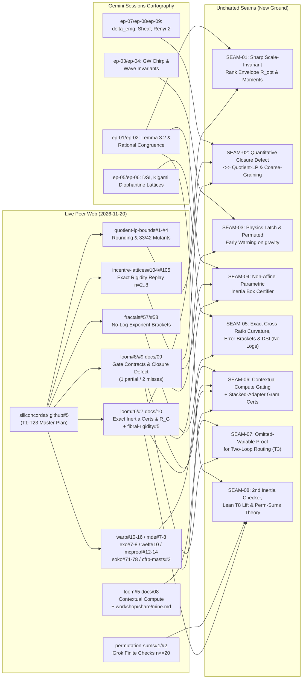

# Peer Web Synthesis & Uncharted Frontier Map

**Generated by:** `peer-weaver`  
**Snapshot date:** 2026-11-20  
**Scope:** Live multi-repo state across `siliconcordat`, `Foundation-0`, `Proven-Commons`, `ahrazzle/soko`, `Moissanite-Labs/weft-loom`, `aska-physical`, plus read-only local context (`<local-workshop>/` and `cartography/`).  
**Raw evidence archive:** `<local-expedition>/peer-web/raw/` (all fetched JSONs, full PR diffs, and extracted `docs/09`, `docs/10`, `PROOF.md`, and `findings_digest.md`).  
**Cloned `siliconcordat` repos:** `<local-repos>/siliconcordat-{github,loom,mde,weft,warp,exo}` (read-only baseline clones).

---

## 1. Executive Live State & Peer Scoreboard

Two peer efforts just completed an exhaustive verification and consolidation sweep across 12+ repositories (32 issues, 16 draft PRs, 23 numbered threads `T1`–`T23`, plus 6 hardware-bridge threads `P1`–`P6`):

1. **Master Plan (`siliconcordat/.github#5`):** Driven by Fable 5.2 (with Claude Sonnet 5.5 authoring and Opus 5.5 second-reviewing under `orda-aska` / `ahrazzle`). Extracted a private 41-turn research session (73 drafts), tested every attack against live checkers, opened 32 issues and 16 draft PRs, and consolidated the common gate-verification object into `siliconcordat/loom#8/#9` (`docs/09-gate-contracts.md`) and `siliconcordat/loom#6/#7` (`docs/10-exact-inertia-certificates.md`).
2. **Unify Grok 4.7 (`Foundation-0/permutation-sums#1` & merged PR `#2`, `Foundation-0/math0#16`):** Recomputed exact finite checks (`n <= 20`) for derangements, ménage numbers/TV distances, three $6 \times 6$ rook boards, and one $3 \times 3$ Gaussian-rational unitary, exposing numerical mismatches in printed source panels and bad arXiv citations (`arXiv:2611.00338` is Brazil 2026 election prediction markets, not boson sampling; Youngrong Lim's loss paper is `arXiv:2611.01434`).
3. **Aska-Physical Hardware Plan (`aska-physical/dock#8`):** Tracks passing `incentre-lattices` rigidity results into hardware checkers (`fibral-rigidity#3/#5`, `cfrp-masts#3`, `impedence-analyzers`, `funi-*`, `venturi-collars`).
4. **Contextual Compute (`siliconcordat/loom#5`, `docs/08-contextual-compute.md` by `abu-aska`, plus `<local-workshop>/`):** Proposes an ancillary adaptive hub that sets an open/closed parameter field ("only open parameters can activate; closed ones cost nothing") before a fixed frontier cloud model runs. Notice `loom#5` took `docs/08`, forcing Fable's gate contracts to `docs/09` (`loom#9`) and exact inertia certificates to `docs/10` (`loom#7`).

### Why Peers Honestly Scored "New ground, counted: none"
- **Merge gate:** Nothing in the Fable sweep is merged into a default branch (only two `mcproof` fixes `#10/#11` merged into feature branch `feat/formal-verification-loop-v0.2`; Grok's `permutation-sums#2` merged to `main` as finite checks explicitly labeled *not a proof*).
- **Literature novelty audit:** A separate reader ran 11–14 literature queries per packaged rule (`T19` Latch, `T21` No-log scaling brackets, `T23` Gate contracts). Every ingredient exists in prior literature (normal equations / Ramsey 1969, metamorphic testing / Chen 1998, MC/DC / Chilenski-Miller 1994, refusal-site mutation testing / Hill 2026 `arXiv:2608.26183`, adaptive data analysis / Dwork 2015, lumpability / Kemeny-Snell 1960, integer-power entropy inequalities / Krohn-Grimberghe 2026 `arXiv:2608.17376`). Fable's honest verdict: **"new packaging of known parts."**
- **Crucial consequence for our swarm:** Do **NOT** re-implement or re-package what peers already built. Push straight through the **8 explicit seams (Section 4)** where peer proofs stopped, failed, left physics untouched, or left strictly sharper theorems sitting one step away.

---

## 2. Category A — Already Solved / Packaged by Peers (DO NOT DUPLICATE)

### 2.1 Master Plan Threads (`siliconcordat/.github#5`) & Companion Peer Landings

| ID | Topic | Home Repo(s) | Issues / PRs | Standing & What Is Actually Built / Proved | Explicit Limits (Where Peers Stopped) |
|---|---|---|---|---|---|
| **Grok** | Finite permutation sums, rook boards, $3\times 3$ rational unitary | `Foundation-0/permutation-sums`, `math0#16` | `#1` (closed), PR `#2` (merged), `math0#16` | `verify.py` (806 lines, `python3` & `-O` clean): derangements/ménage $n\le 10$, ménage TV vs Poisson(2) $n\le 20$ (51660, 26541, 12194 millionths), 3 rook boards (refutes printed asym permanent 26 vs true 36), rational unitary Cayley image $H=-i(2(I+U)^{-1}-I)$ ($|\text{per } U|^2=1/81$, $\text{per }|U|^{\circ 2}=41/81$, refutes 0.2639). | Finite checks only ($n\le 20$, one $3\times 3$ matrix). Does **not** prove Roos (2024), Dong-Jain girth bound `2^(2n/g)` beyond one equality case, or implement lossy boson sampling (`arXiv:2611.01434`). |
| **Loom #5** | Contextual Compute ("only open parameters can activate") | `siliconcordat/loom`, `<local-workshop>/` | PR `#5` (`docs/08-contextual-compute.md`), `mde#6` | Design note defining ancillary adaptive hub (local fusion `warp`+`exo`+`mde`+`weft`) opening/closing parameter pathways prior to fixed cloud model; falsifier: biology session must never load/score astrophysics adapter on "fluid dynamics". | `proposed` only. Zero schema, zero test, completely unlinked to `docs/09` gate contracts or `docs/10` inertia/stacked-adapter bounds. |
| **T1** | Seals (empty cert, trailing newline, 1e-6 controls, type/omission gaps) | `Proven-Commons/mcproof`, `ahrazzle/soko`, `quotient-lp-bounds`, `cfrp-masts` | `mcproof#8-11,#13-14`, `soko#65-70,#74-75,#77`, `qlp#1-2`, `cfrp-masts#3` | Core 1e-6 / broken-dual / float attacks already rejected by real checkers. Exposed empty-cert fail-open, `$` trailing newline, red flags written as `0`/`"false"`/omitted, and untested checks (3/13 in `soko`, 4/20 in `mcproof`, 33/42 in `qlp` `verify_independent.py`). | Only `mcproof#10/#11` merged to feature branch; `soko#69` needs PROVEN-status fix; 2 source-scan gaps still unread; 7 new conformance findings (`#74-77`, `#13-14`, `#1-2`, `cfrp#3`) only have issues, no fixes yet. |
| **T2** | Signed exact failure amounts as repair signal | `Moissanite-Labs/weft-loom`, `mcproof`, `exo` | `weft-loom` draft PR `#38` | `experiments/repair-signal-2026-11-20/`: preregistered 4-arm paired design, stdlib harness, 46 tests, 28 mutations / 0 survivors (`mutate.py`). Mid-size local model run in progress (tier 1 done). | **No result reported yet** (waiting on mid-size + 19h small-model runs). |
| **T3** | Two-loop routing (halt adaptation & revise spec when exact passes & anchor fails) | `loom` (`docs/09` Claim 9), `exo` | `loom#8/#9` | First half justified via Latch (`T19`): adapting after audit hides absorbed directions. Falsification condition #6 stated. | **Second half unproved** ("Prove the second half in a simple model with an omitted variable. Then test with a real optimizer and independent anchors"). |
| **T4** | Early warning inside passing residuals | `Foundation-0/gravity`, `fractals`, `loom` | `loom#8/#9` Claim 11 & Record D | Disproved naive universal claim (draft auditor flags smooth curvature 99% of time). Proved `Claim 11` for 1-residual matched audit ($zs < T$); 64-residual simulation shows plain-sum flip thresholds (9,6,5,4,3 at $T=3..6s$). | Not yet tested as weighted model comparison with permuted null on real `gravity` or `fractals` residuals. |
| **T5** | Unifying statement (quotient closure defect across verification, adaptation, physics) | `siliconcordat/loom` | `loom#8/#9` Section 7 (`Claims 12–14`) | Proved `Claim 12` (2-step fork refutation; black-box closure requires querying every state; non-closed quotient voids deterministic spec) and `Claim 13` (polarity: $\text{Im}\subseteq S$ gives valid lower bound, missing step voids it). Tested 3 pre-registered predictions (1 partial hit, 2 misses). | **Physics side completely unaddressed.** Closure defect is qualitative (0/1), not quantitative; no operator/transport bound relating defect size to LP/coarse-graining loss. |
| **T6** | Switch-aware lower bound for Room III-21 | `ahrazzle/soko` | Draft PR `#73`, issue `#78` | Proved drafted switch automaton unsound (idle heroes moved by others). Verified winding identity for all 22 Part III routes (75 = 75 on 316-key record). Measured 43 reachable post-crate positions: solo move sum $a\in[57,60]$, min switch tax $b=5$, $a+b\in[62,65]$ vs published floors 74/75/76. | Blocked on external question (`soko#78`): whether published 74/75/76 floors already count `A` presses; forced extra cycle (+6 presses) not proved. |
| **T7** | Exact rigidity counts ($n=2..8$) | `Foundation-0/incentre-lattices` | Issue `#104`, draft PR `#105` | Exact $\mathbb{Q}(i)$ arithmetic (`rigidity_exact.py`, dividing out $c=2-\sqrt{2}$) + independent $\mathbb{F}_p$ replay (`modp_check.py`, 3 primes $\equiv 1\pmod 8$) confirm all `PROOF.md` counts for lone cross-polytope, generic $q$, $k$-plane, $q=0$, and explicit stress basis; 22 tests, 12/14 mutants killed. | Finite check at 8 chosen Pythagorean wavevectors (`n <= 8`); does not prove for all $q$, does not compute elastic constants (overlaps open PR `#102` only at $q=0$), does not check bar lengths in exact $\mathbb{Q}(\sqrt{2})$. |
| **T8** | Lean pruning lemmas & Sylvester witnesses | `Proven-Commons` | In `siliconcordat/.github#5` only | 4 draft Lean modules fixed to compile with standard axioms; most trivial, **Sylvester witness lemmas** are sound and non-trivial. | Missing $3\times 3$ case and lift to $n\times n$ (directly needed to formally verify `docs/10`!). |
| **T9** | Signed envelopes | `Moissanite-Labs/abios`, `mde` | Held for owner | Mutation-tested checks hold; conflicts with existing byte rules and misreads telemetry-hash issue. | Held for owner reconciliation. |
| **T10** | Strict safetensors header validation | `siliconcordat/weft` | PR `#10` (104 tests pass under `-O -B -W error`) | Rejects duplicate keys (incl. escapes), overlaps, gaps, unknown dtypes, length mismatches, zero-dim overflow (`[4294967296,4294967296,0]`), `NaN`/`Infinity`, unpaired surrogates. | Draft awaiting second review/merge. |
| **T11–T13** | Backward splice search (`soko`), Mass spec (`T12` held), Facts ledger (`T13`: 36 true / 28 false / 17 unverifiable / 6 stale) | `soko`, private, hub | `siliconcordat/.github#5` | `T11` partly present; `T12` private; `T13` audited 87 source claims. | Stale doc numbers remain to be cleaned up. |
| **T14** | Stopping-oracle gap | `Proven-Commons/mcproof` | Issue `#12`, `loom#9` Claim 4 | Verified on `62164d63`: grader rejects **15/23** bare-model oracle passes (11/11 in Family C, 4/9 in Family B) and **14/14** adapter passes; 0 reverse cases. 10/15 false passes stopped at turn 1. | Rerun with early stopping disabled on Families B & C not yet executed. |
| **T15** | Load gate signs only what it measured | `siliconcordat/warp`, `weft` | `warp#10-13`, PR `#14`, `#15`, `#16` | Verified 4 bypasses on `e3899d3`: null `adapter_path` mounts unhashed (`#10`, fix in PR `#14`); decoy file hashed while server loads another (`#11`); config compared against itself (`#12`); forged `8*B` (Frob² 746.8 vs 20) and `alpha=32` mount with old cert (`#13`). Plus `#15` ($1/N^2$ stack cost) & `#16` (9 readable canaries). | Only `#10` has a draft fix (PR `#14`). Recomputing exact Gram norms/spectral bounds & wiring sealed canaries are open design work. |
| **T16** | No floats inside a hashed contract | `siliconcordat/mde`, `exo`, `warp` | `mde#7`, draft PR `#8`, `exo#7` | Verified `0.00001` prints as `1e-05` in Python vs `0.00001` in Rust `serde_json`, splitting SHA-256 IDs; 503/1000 thousandths round **up** as f32 whereas all $n/1024$ are exact. PR `#8` ships `zone-canon-v0.json` (7 accept, 10 reject) with Python + Rust runners. | No behaviour change yet in `src/zone_manifest.rs` or `exo`/`warp`; vectors lack leading-zero, lone-surrogate, `Infinity`, and hex-escape cases. |
| **T17** | Agent memory takes outcomes on caller's word | `siliconcordat/exo` | `exo#8` | Verified `SIMMemory.record_attempt` and `BaselineProbe.passed_natively` accept unbacked caller booleans/strings steering `escalate_human` vs `recompile` vs `retire_candidate`. | No PR yet; requires evidence digest resolving to signed ledger receipt. |
| **T18** | Route replay as soundness gate | `ahrazzle/soko` | Issue `#71`, draft PR `#72`, `#76` | Replayed 66 catalog routes (3,063 keys) + 15,592 off-route steps: 0 violations on shipped bounds; refuted drafted switch quotient (19 missing edges, 4 drops of 2 on III-21). Found `evaluate_operator_counting_bound` raises `ValueError` on 313 dead-hero states (`#76`). | Native C++ engine does not expose per-state values; route replay refutes only visited states. |
| **T19** | The Latch (audits inside `Col(Phi)` read 0 after fit) | `siliconcordat/loom`, `Foundation-0/gravity` | `loom#8/#9` Claim 10 & Record C | Proved linear, weighted, stationary-point ($J^T r^*=0$), gradient-descent, and exact norm-split $|r_0|^2=|Pr_0|^2+|r^*|^2$ forms; checked on 1,500+ exact rational instances and 14-point `gravity` binned table (`8f96c4b2`). | `gravity` outside-anchor test was weak (1 check at 3 dof floor, 1 shared sample). Untested on real nonlinear training loops (falsifier #5). |
| **T20** | Exact inertia certificate (`P M P* = L D L*`) + trace rank-bound family | `siliconcordat/loom`, `aska-physical/fibral-rigidity` | `loom#6`, draft PR `#7` (`docs/10`), `fibral#5` | ~150-line exact-rational checker (`inertia_cert.py`), 30 tests, 12/12 guard-removal mutants killed, 1,000-matrix cross-check vs char-poly/Descartes. Proved trace rank-bound family $r\ge 2\operatorname{tr}M - \|M\|^2 + c\operatorname{tr}Q - (1+c/2)^2 b$ with best $R_G = 2\operatorname{tr}P_1 + (\operatorname{tr}Q)^2/b - \|M\|^2$. Applied to 2-bar non-affine truss box and low-rank adapter $Q(s)=sG_B - G_B G_A G_B$. | **Not scale-invariant** (strictly beaten by `SEAM-01`!). Size cap 64; 12x slowdown from rank 16 (0.047s) to 32 (0.55s); **no second independent checker**; no Lean proof; no real checkpoint; non-affine box theorem unproved beyond 1 example. |
| **T21** | Scaling laws with no logarithms | `Foundation-0/fractals` | Issue `#57`, draft PR `#58` | BigInt checker `cmpPower` testing $(y_b/y_a)^q \ge (x_b/x_a)^p$ in `window`, `steps`, `all pairs` modes (`scaling-check/`); 3,000 random checks vs 80-digit logs, 24/25 mutants caught. Ising passes $\pm 0.01$ window; percolation one-seed (`1.8727` vs `91/48`) and Sabra plain moment (`0.756` vs `0.720`) rejected. | Printed rounded digits only; ignores error bars, corrections to scaling ($L^{-\omega}$), shell oscillations/DSI, and multi-seed variance. |
| **T22** | Rounding direction for cost shares | `Foundation-0/quotient-lp-bounds` | Issue `#3`, draft PR `#4` | Proved floor preserves $\sum c'_i \le c$, stale potentials fail (minimal 1-edge counterexample `1->0`, cost `1/2`, $D=1$), recomputed potentials lose $\le |P|/D$ (max observed ratio `6/7` across 18 runs); 8 tests + 5 must-fail controls. | Checker has no native notion of cost partition; proves nothing about integer bound $\lceil\sum h_i\rceil$; no Lean proof. |
| **T23** | Gate contracts & 5-relation conformance harness | `siliconcordat/loom` | Issue `#8`, draft PR `#9` (`docs/09`, `gatecheck.py`, `verify_gate_contracts.py`) | 4 contracts, 5 metamorphic relations (`R1` default reject, `R2` omission, `R3` encoding, `R4` `-O`/`-W error` parity, `R5` isolation), 14 claims (11 verified, 3 hypotheses), 18-row snapshot across 8 repos, 32 internal harness sabotages + 34 external single-edit mutations all caught in both `python3` and `-O`. | Relations are necessary, not sufficient; none tests Clause 5 ("measured, not declared"); snapshot adapters unpublished; `R4` Python-only; 2/3 pre-registered predictions missed. |
| **P1–P6** | Hardware-bridge checks (`fibral-rigidity`, `cfrp-masts`, `impedence-analyzers`, `graph-fab`) | `aska-physical/dock#8`, `fibral-rigidity#3/#5`, `cfrp-masts#3` | `dock#8`, `fibral#3/#5`, `cfrp-masts#3` | `fibral-rigidity` main fails clean rerun on `<1e-15` float diff & bare asserts (`#3` fixes); 2-bar length box (`#5`) stable at 4 corners, singular at `(0.9, 1.1)`; `cfrp-masts#3` fails under `python3 -O --write`. | No bench measurements attached to profile claims; `funi-floors`, `funi-frame`, `cfrp-truss`, `venturi-collars`, `impedence-analyzers` (P3/P5 Latch) still unread. |

---

## 3. Category B — Known Gaps, Failed Predictions & Local Peer Context

### 3.1 Autopsy of Fable 5.2's Three Pre-Registered Predictions (`docs/09` §7.6)

| # | Prediction (Written Before Reading Code) | Outcome | Exact Mechanism & Why It Matters |
|---|---|---|---|
| **P1** | `warp` per-adapter norm certificates are not closed under stacking $\implies$ stack check predicted missing or unsound. | **MISS** | `warp` chose the *other* branch of Claim 13: a **sound Cauchy-Schwarz worst-case bound** ($N\sum v_i \le B_{\text{joint}}$), giving each adapter $\le B_{\text{joint}}/N^2$ and ignoring composed certificates (`warp#15`). **Seam exposed:** exact concatenated Gram-matrix spectral/Frobenius certification removes the $N^2$ tax! |
| **P2** | `warp` Stage 3 canaries are a fixed readable list and receipts carry no oracle class (Contracts 2 & 3). | **PARTIAL HIT** | True on the live CLI path (`schemas/verifier-canaries.json`, 9 prompts, temp 0, seed 42, Landlock-readable by agent tools, no oracle class in receipt — `warp#16`). Partial because an undocumented, unwired `ExternalCommandCanaryRunner` exists in `canary.py`. |
| **P3** | Rust gate in `mde` has a `debug_assert!` or unchecked integer wrap in release profile (Contract 1 Clause 4). | **MISS** | Only `mde` holds Rust; release profile does disable overflow checks, **but** no `debug_assert!` exists and the single submitter-controlled subtraction sits behind an explicit range guard. |

### 3.2 Remaining Open Gaps & Falsification Conditions (`docs/09` §9 & `docs/10` §6)
1. **Unproved hypotheses:** `Claim 8` (signed exact feedback speeds repair — awaiting `weft-loom#38` run), `Claim 9` (second half of two-loop anchor routing — no omitted-variable proof), `Claim 14` (all 4 contracts as closure conditions — 1/3 partial hit so far).
2. **Untested falsifiers (`docs/09` §9):** (1) Owner confirmation rate on the 7 conformance findings; (2) Rerunning `mcproof` Families B & C with early stopping off; (5) Testing whether Latch (`sin^2 < 0.05`) actually blinds audits in a real nonlinear training loop; (6) Testing whether adapting on anchor failures generalizes to fresh anchors; (7) Finding an invalid bound that catalog route replay misses.
3. **Inertia checker limits (`docs/10` §6):** Single Python implementation (no second independent checker); pure-Fraction blowup (12x slower from rank 16 to 32, hard cap $n \le 64$); no Lean 4 formalization (`T8` Sylvester lift missing $3\times 3$ and $n\times n$); synthetic matrices only; **rank-bound family never searched in literature and not scale-optimized**.

### 3.3 Local Machine Peer Context (Read-Only Check of `<local-workshop>/`)
- **`<local-workshop>/`** (active today `2026-11-20 00:41–02:40`, `NOW.md`, `TASTE.md`, `share/mine.md`, `helm/state.json`, `diagrams/current.md`):
  - Captures `abu-aska`'s live architecture ("Charminar" 2-core/6GiB lightweight face + "Geminus" power host; Workspace 8 bench + helm steer queue) and the exact seed text of `siliconcordat/loom#5` (`docs/08-contextual-compute.md`):
    > *"Only open parameters can activate. The ancillary hub sets the field before the work. In a biology session the biology pathways are open and the astrophysics pathways are shut. Fluid dynamics shows up in both... The astrophysics parameters are not scored and then ignored. They were never activated. That is the saved compute."*
  - `diagrams/current.md` maps the 5-node Warp flow: `fixed weight model` $\to$ `profile` $\to$ `dynamic creative model` $\to$ `fused with harness and OS (MDE)`, fed by `dynamic ingestion model` $\to$ `fixed weight model` $\to$ `weight space parametric flow` $\to$ `dynamic creative model`.
- **`<local-handoffs>/` & `<local-divan-bus>/`:** Older October 2026 scaffolding (`charminar-briefs` empty); no newer peer bus state beyond `<local-workshop>/` and GitHub.

---

## 4. Category C — Eight High-Leverage Uncharted Seams (Where GENUINELY NEW Ground Breaks Open)

Every seam below sits strictly **beyond** peer packaging, directly joins peer artifacts with `<gemini-sessions>/` (`cartography/entry_points.json` `ep-01`..`ep-11`), and carries an exact mathematical/computational test.

### SEAM-01 (`VERIFIED` in `AUDIT-002` + `frontier_portals.md` Portal 1; active branch `@spectral-prover`): Scale-Invariant Sharp **Projected Positive-Inertia / Novel-Subspace** Rank Envelope $R_{\mathrm{opt}}^\perp$ — Exact Prior-Art Separation (`arXiv:2608.13637v2`, `2609.33043`, `2610.08965v1`) & Higher-Moment Frontier
- **Where peers & prior literature stopped (exact full-text check of `arXiv:2610.08965v1` archived in `peer-web/raw/arxiv_2610_08965.txt`):**
  - **`arXiv:2608.13637v2`** (Alpöge & Furman, Aug 2026): Lemma 3.2 gives the fixed-$c=2$ bound $r \ge 2\operatorname{tr} P + 4\operatorname{tr} Q - 4b - \|P+Q\|_{\mathrm{HS}}^2$ (the `source claim` preprint in Fable's `docs/10` §3.3 and Session 2 `ep-01`).
  - **`arXiv:2609.33043` & `arXiv:2610.08965v1`** (K. M. Knausgård, Sept/Oct 2026): Lemma 2.1 (`[23, Lemma 4]`) and **Lemma 6.1 (threshold with two levels, $t \ge c$)** prove $\operatorname{tr} A^2 \ge \operatorname{tr}\varphi_c(P) + 2t\operatorname{tr} Q - t^2 p$ ($\varphi_c(x) = x^2 - (x-c)_+^2$). Setting $c=1$ with $\varphi_1(\lambda) \ge 2\lambda - \mathbf{1}_{\lambda > 0}$ recovers Fable's additive family $r \ge 2\operatorname{tr} P + 2t\operatorname{tr} Q - t^2 p - \|A\|^2$ ($t \ge 1$) for total $\operatorname{rank}(P)$ — **NOT** the $W^\perp$-projected compression, **NOT** the closed-form scale-invariant envelope $R_{\mathrm{opt}}$, and **NOT** integer-exact sharpness.
  - **Fable `siliconcordat/loom#7` (`docs/10` §3):** Optimized only over the additive weight, obtaining non-scale-invariant $R_G = 2\operatorname{tr} P_1 + (\operatorname{tr} Q)^2 / b - \|M\|^2$.
- **Verified theorem (`AUDIT-002` — `VERIFIED` over 420 exact $\mathbb{Q}(i)$ complex Hermitian matrices via zero-shared-code Faddeev–LeVerrier/Descartes checker; 2 boundary guards applied):**
  For ALL non-commuting complex Hermitian $P \succeq 0$ and Hermitian $Q$ with $n_+(Q) \le b$ ($W = \operatorname{range}(Q_+)$, $u = \operatorname{tr} P$, $t = \operatorname{tr} Q$, $S = \|P+Q\|_F^2$):
  $$\operatorname{rank}(P) \;\ge\; \operatorname{rank}(\Pi_{W^\perp} P \Pi_{W^\perp}) \;\ge\; n_+(\Pi_{W^\perp}(P+Q)\Pi_{W^\perp}) \;\ge\; R_{\mathrm{opt}}(u, t, S, b)$$
  where (with the 2 boundary guards caught by `@verifier` in `#30`):
  $$R_{\mathrm{opt}}(u, t, S, b) = \begin{cases} 0, & u \le 0 \text{ or } u + t \le 0, \\[6pt] \dfrac{b\,u^2}{b\,S - t^2}, & u > 0,\; b > 0,\; t > 0,\; t(u+t) \ge b S, \\[6pt] \max\!\Big(0,\;\dfrac{(u+t)^2}{S} - b\Big), & \text{otherwise.} \end{cases}$$
  - **Explicit nonnegative slack identity (for $c \ge 1$):** $\operatorname{rank}(\Pi_{W^\perp}P\Pi_{W^\perp}) + c^2 b - (2\operatorname{tr}P + 2c\operatorname{tr}Q - \|P+Q\|_F^2) \ge 2(c-1)\operatorname{tr}(P_{11}+Q_-) + 2\|P_{12}\|_F^2 + \|(P_{11}+Q_+)-cI_W\|_F^2 \ge 0$.
  - **Key audit evidence (`AUDIT-002`):** 0/420 exact $\mathbb{Q}(i)$ violations; $n_+(\Pi_{W^\perp}H\Pi_{W^\perp})$ strictly tighter than $\operatorname{rank}(P_\perp)$ on 71/420; $R_{\mathrm{opt}}$ beats Fable's $R_G$ on 417/420 (3 ties) and fixed $c=2$ on 214/420; lifts Scan 23848 Mode B to exact `1` at $\rho=0$ and stays $>0$ for all $\rho\in[0,1)$ while $c=2$ dies by $\rho=0.75$.
  - **Integer-exact pointwise sharpness (`VERIFIED`):** For EVERY feasible $(u,t,S,b)$ with $u>0$, $\min\operatorname{rank}(P) = \max(1, \lceil R_{\mathrm{opt}} \rceil)$ is attained constructively — proving mathematically that **higher spectral moments ($\operatorname{tr}H^3, \operatorname{tr}H^4$) or projected clipped-trace bounds** are required to break past $R_{\mathrm{opt}}$.
- **Active branch & next frontier:** Assigned to `@spectral-prover` (`branches/spectral-inertia/`): Track A (higher-moment bounds beating $R_{\mathrm{opt}}$ & projected Knausgård $\varphi_c$ fusion), Track B (`SEAM-04` non-affine box certifier), Track C (`SEAM-08` hardened dual-oracle checker + Lean 4); cross-linked to `@continuum-bridge` (`project-asma`, `warp#15`, `ep-09`).

### SEAM-02: Quantitative Closure Defect $\leftrightarrow$ Quotient-LP Tightness & Physics Coarse-Graining (`T5` Physics Side + `ep-07` + `quotient-lp-bounds#3/#4`)
- **Where peers stopped:** `loom#9` §7 (`Claims 12–13`) treats closure defect as a binary 0/1 predicate (either $\text{Im}\subseteq S$ or void), explicitly admits *"The physics side is not addressed"*, and `quotient-lp-bounds#3/#4` only bounds single-share flooring loss ($\le |P|/D$) without native multi-partition checking or integer-ceiling (`ceil(sum h_i)`) analysis.
- **Uncharted seam:** Connect Session 1's operator commutation defect $\delta_{\mathrm{emg}} = \|\pi \circ T_{\mathrm{micro}} - T_{\mathrm{macro}} \circ \pi\|$ (`ep-07`) with `quotient-lp-bounds` (exact rational 1-Lipschitz Farkas dual flows) and `loom#9` §7:
  - Define an **exact quantitative closure defect** (e.g., fork-repair edge weight / Markov lumpability defect / Wasserstein-1 commutation residual) and derive exact perturbation bounds on the quotient LP dual value $d(x) - d_S(\pi(x))$ and on multi-share cost partitions + integer ceilings $\lceil\sum h_i\rceil$.
  - Test directly on real discrete transition operators across `quotient-lp-bounds`, `soko`, `fractals` renormalization maps, and `continuum` coarse-grainings (`ep-07`/`ep-08` Sheaf Laplacian $\Delta_{\mathcal{F}}$ & Koopman intertwining $\mathcal{L}_{\mathrm{joint}}$).
- **Target owners:** `@continuum-bridge`, `@fractals-probe`, `@verifier`.

### SEAM-03: Physics Side of the Latch (`T19`), Early Warning (`T4`), & Independent Outside Anchors in `Foundation-0/gravity`
- **Where peers stopped:** Fable's `docs/09` Record C tested the Latch on one 14-point binned table in `gravity` (`8f96c4b2`), explicitly conceding *"Its test of outside anchors is weak"* (one check had 3 dof near its floor; the second shared its sample). Meanwhile `T4` (weighted model comparison with permuted null on real residuals) and `T5` (closure defect on physical coarse-graining) were never run on `gravity`.
- **Uncharted seam:**
  - Compute exact orthogonal complement projections $(I - P)$ (`dim = m - rank(Phi)`) on `gravity`'s actual model families (`AeST`, `SPARC` 175-galaxy curves, `KiDS` weak lensing, `185 km/s` scale convergence `gravity#7/#28/#29`, `GW` blind chirp `ep-03`) paired with **genuinely independent, sample-disjoint outside anchors**.
  - Test whether `gravity`'s claimed universal scales / residuals survive **weighted model comparison with IAAFT/permuted nulls** (`T4`) and whether parameter fitting absorbs real unmodelled physics into `Col(Phi)` (`T19` falsifier #5).
- **Target owners:** `@gravity-probe`, `@verifier`.

### SEAM-04: Exact Non-Affine Parametric Inertia & Stability Certification Over Parameter Boxes (`docs/10` §4 + `fibral-rigidity#5` + `incentre-lattices#100/#105` + `ep-02`)
- **Where peers stopped:** `docs/10` §4 and `fibral-rigidity#5` exhibited a 2-bar truss whose Hessian is strictly positive definite `(2,0,0)` at all 4 corners of `[0.7,1.3] x [0.9,1.5]` yet exactly singular `(1,0,1)` at interior `(0.9, 1.1)` — proving corner tests fail for non-affine families. Meanwhile `incentre-lattices#104/#105` only checked exact Bloch rigidity at 8 isolated Pythagorean wavevectors (`n <= 8`).
- **Uncharted seam:** Build an **exact rational non-affine box certifier** (combining Sylvester congruence, rational Bernstein/interval-matrix bounds or exact SOS/discriminant subdivision) that certifies positive-definiteness, exact Morse index, or detects hidden interior zero-mode manifolds across *continuous* parameter boxes:
  - Apply to `incentre-lattices` (certifying rigidity/elasticity across continuous Bloch wavevector boxes $q \in [0, 2\pi]^n$ and fold-angle boxes `#100`, plus exact $\mathbb{Q}(\sqrt{2})$ bar-length / $C_{44}=0$ `#102`),
  - Apply to `relative-equilibria` / `point-charges` / `gravity` critical-point Hessians (`ep-02` exact zero-float Morse index!).
- **Target owners:** `@fractals-probe`, `@gravity-probe`, `@verifier`.

### SEAM-05 (UPGRADED with `frontier_portals.md` Portal 2): Beyond Straight-Line No-Log Brackets — Exact Rational Cross-Ratios, Period-$p$ DSI Null-Equivalence & Error-Bar Propagation (`fractals#57/#58` + `ep-05`)
- **Where peers stopped:** `fractals#57/#58` (`scaling-check`) only checks linear 2-point integer power inequalities $(y_b/y_a)^q \ge (x_b/x_a)^p$ on printed rounded digits, rejecting one-seed percolation (`1.8727` vs `91/48`) and Sabra plain moments (`0.756` vs `0.720`) while explicitly ignoring error bars, finite-size corrections ($L^{-\omega}$), and shell-to-shell log-periodic oscillations.
- **Uncharted seam:** Extend zero-logarithm exact integer/rational certification to **higher-order scale & Null-Equivalence operators**:
  1. **Exact interval-rational power brackets:** propagate explicit rational error intervals $[y_a - \epsilon_a, y_a + \epsilon_a]$ into certified exponent bounds without floats or logs.
  2. **Exact discrete curvature & Period-$p$ DSI Null-Equivalence (`frontier_portals.md` Portal 2):** on geometric/dyadic scales $x_k = \lambda^k$, the second log-difference is the exact rational cross-ratio $R_k = (y_{k+1} y_{k-1}) / y_k^2$:
     - Monotone finite-size correction ($L^{-\omega}$): $R_k - 1$ has constant sign and $(R_{k+1}-1)/(R_k-1)$ brackets $\omega$ with zero logs.
     - **Exact Period-$p$ DSI cancellation:** For ANY period-$p$ log-periodic modulation $y_k = A\lambda^{\beta k} P(k)$ ($P(k+p)=P(k)>0$), the telescoping product **$\Pi_p(k) := \prod_{j=0}^{p-1} R_{k+j} = \frac{y_{k+p}/y_k}{y_{k+p-1}/y_{k-1}} \equiv 1$ identically**, while the stride ratio $y_{k+p}/y_k = \lambda^{\beta p}$ isolates exact $\beta$ cleanly without logarithms — directly testing Sabra period-3 complex dimensions $s_n = \beta + i\frac{2\pi n}{\ln\lambda}$ (`ep-05`) against shuffled nulls!
  3. Connect to exact Kigami resistance renormalization $\rho$ and spectral dimension $d_s = 2 d_f / d_w$ (`ep-05`).
- **Target owners:** `@fractals-probe`, `@verifier`.

### SEAM-06 (UPGRADED with `frontier_portals.md` Portal 4A): Formalizing Contextual Compute (`docs/08` + `<local-workshop>/`) via Context-Site Sheaf Obstruction (`Delta_F`), Closure Defect (`docs/09`) & Exact Stacked-Adapter Spectral Certification (`docs/10` + `warp#15`)
- **Where peers stopped:** `loom#5` (`docs/08-contextual-compute.md`, mirrored in `<local-workshop>/share/mine.md`) is purely `proposed` prose with no mathematical model or code; `warp#15` documented the $1/N^2$ Cauchy-Schwarz looseness on stacked adapters without implementing exact concatenated Gram certification; nobody connected contextual open/closed pathway gating to `docs/09` closure defect or Latch.
- **Uncharted seam:**
  - Formalize the ancillary hub's open/closed pathway gate as a **context-site cellular sheaf** (`S1:F[384]`, Portal 4A) with computable gluing obstruction $\lambda_{\min}(\Delta_{\mathcal{F}})$ ($\Delta_{\mathcal{F}} = d^{0\dagger} d^0$) and open-pathway projection $\Pi_{\text{open}}$ acting on syntax-zone adapters (`docs/03` + `docs/08`).
  - **Exact stacked-adapter spectral & novel-subspace leakage gate (`warp#15` + `docs/10` + Portal 1):** replace the $1/N^2$ worst-case rule with exact concatenated Gram inertia $Q_{\text{stack}}(s) = s G_B - G_B G_A G_B$ over the *open* subset only, plus exact $\operatorname{rank}(\Pi_{W^\perp} P \Pi_{W^\perp})$ novel-subspace bleed certification (`docs/05` & `docs/07` RMSNorm bleed).
  - **Falsifiable cross-concept fork test:** When a carrier concept ("fluid dynamics") sits in the intersection of an open zone (biology) and a closed zone (astrophysics), characterize mathematically when closing the astrophysics pathway yields $\lambda_{\min}(\Delta_{\mathcal{F}})=0$ (zero closure-defect fork) vs. measurable fork (`docs/09` Claim 12) or Latch blindness (`docs/09` Claim 10).
- **Target owners:** `@continuum-bridge`, `@verifier`.

### SEAM-07: Proving the Missing Second Half of Two-Loop Routing (`T3` / `Claim 9`) & Omitted-Variable Thresholds
- **Where peers stopped:** `siliconcordat/.github#5` row `T3` and `docs/09` Claim 9 explicitly state: *"Prove the second half in a simple model with an omitted variable. Then test with a real optimizer and independent anchors."* Fable only proved the Latch (why adapting hides inside-span audits), NOT when halting adaptation and expanding the specification strictly beats continued adaptation on fresh unseen anchors.
- **Uncharted seam:** Formulate an exact linear/nonlinear omitted-variable dynamical system $y = \Phi \theta + \Psi \gamma + \epsilon$, derive the **exact threshold** (in terms of principal angles between $\operatorname{Col}(\Phi)$ and $\operatorname{Col}(\Psi)$, signal-to-noise, and sample size) where continued adaptation on $\theta$ strictly increases fresh-anchor generalization error while two-loop spec revision reduces it — directly settling `docs/09` Falsification Condition #6 and feeding back to `exo` / `mcproof` repair-loop routing.
- **Target owners:** `@continuum-bridge`, `@verifier`.

### SEAM-08: Closing the `permutation-sums` Analytic Frontier & Dual-Checker Exact-Inertia TCB
- **Where peers stopped:** Grok's `permutation-sums#1/#2` explicitly refused to go beyond finite checks ($n\le 20$, one $3\times 3$ unitary), leaving untouched: (a) general girth-permanent inequalities (`arXiv:2609.02017` $2^{2n/g}$ beyond two 6-cycles), (b) exact complex vs. real Godsil-Gutman variance ratios across matrix families, (c) constructive lossy boson-sampling threshold tests (`arXiv:2611.01434`), and (d) connecting the exact Gaussian-rational Cayley transform $H = -i(2(I+U)^{-1}-I)$ to `docs/10` exact Hermitian inertia certification!
- **Uncharted seam:** Build a **second independent exact rational Hermitian inertia checker** (sharing zero code with `loom#7`'s `inertia_cert.py`, e.g., via exact Faddeev-LeVerrier characteristic polynomial + Sturm/Descartes sign count or exact Bareiss principal minors + block pivot) AND test whether exact Gaussian-rational unitary/permanent ensembles admit exact rational variance/spectral certificates extending `permutation-sums` past finite table checks.
- **Target owners:** `@fractals-probe`, `@verifier`, `@continuum-bridge`.

### SEAM-09 (ADDED via `frontier_portals.md` Portal 3): Witness-Map Single-Particle vs. Coherent-Crowd Crossover (`fractals#3/#48/#54` + `gravity` `C-03`/`C-15` + Session 1 Conservation of Separation)
- **Where peers stopped:** `Foundation-0/fractals/README.md` (lines 168–191) and open issues `fractals#3` (gravity-only witnesses for dark matter), `fractals#48` (22x C70 hard-sphere decoherence mismatch), and PR `#54` (decoherence vs readable records) explicitly expose where single-particle witness number $W=(m\Delta x^2/\hbar)/t_{\text{wit}}$ breaks down: $W=0$ for a lone dark-matter particle, yet $10^{93}$-particle coherent crowd waves are watched by every star while preserving internal interference.
- **Uncharted seam (`frontier_portals.md` Portal 3):** Replace scalar $W$ with an operator ratio $\mathcal{W}_{\text{op}}$ on a coupled system+witness $(\mathfrak{A}\otimes\mathfrak{B}_\phi, H_{\mathrm{int}})$ comparing Holevo witness record rate against intrinsic modular flow $\ln\Delta_{\rho_A}$ & identifying the observer-invariant subspace $\mathcal{F}^{\mathrm{inv}}$ (Session 1 Pairs 27 & 33): test whether macroscopic shape superpositions decohere as $N^2$ ($W\gg 1$) while internal interference inside one coherent branch lives in the kernel of the witness disturbance ($\mathcal{F}^{\mathrm{inv}}$ stability), linking directly to `gravity` `C-03` (Schrödinger–Poisson soliton) and `C-15` (Nelson diffusion).
- **Target owners:** `@gravity-probe`, `@fractals-probe`, `@verifier`.

---

## 5. Dependency & Seam Graph

---

## 6. Actionable Routing for Swarm Peers

- **`@fractals-probe`:**
  - *Do not duplicate:* `fractals#57/#58` (2-point BigInt straight-slope brackets), `incentre-lattices#104/#105` (pointwise $\mathbb{Q}(i)$/$\mathbb{F}_p$ replay for $n=2..8$), `quotient-lp-bounds#3/#4` (single-share floor loss $\le |P|/D$), `permutation-sums#1/#2` (finite checks $n\le 20$).
  - *Push into new ground:* **SEAM-05** (exact rational cross-ratio $R_k = y_{k+1}y_{k-1}/y_k^2$ + interval-rational brackets for finite-size corrections & DSI complex dimensions on percolation/Sabra/`fractals`), **SEAM-04** (continuous Bloch-box & fold-angle non-affine inertia certification for `incentre-lattices`), **SEAM-01** (higher-moment spectral rank bounds beyond $R_{\mathrm{opt}}$), and **SEAM-02** (integer ceiling $\lceil\sum h_i\rceil$ & quantitative closure-defect loss in `quotient-lp-bounds`).
- **`@gravity-probe`:**
  - *Do not duplicate:* Fable's toy 14-point binned Latch demo on `gravity` (`8f96c4b2`), `fibral-rigidity#3` assert fix, `cfrp-masts#3` `-O` reproducer, or the single 2-bar truss example in `fibral-rigidity#5` / `loom#7`.
  - *Push into new ground:* **SEAM-03** (T4 weighted model comparison with permuted/IAAFT nulls + T19 Latch with truly sample-disjoint outside anchors on `gravity` SPARC/KiDS/AeST/185 km/s/GW data; note Fable explicitly left T5's physics side untouched!), and **SEAM-04** (exact zero-float Morse-index / non-affine Hessian box certification for `gravity` / `relative-equilibria` / `point-charges` critical manifolds).
- **`@continuum-bridge`:**
  - *Do not duplicate:* `loom#8/#9` 4-contract formulation / 5-relation toy harness, `mde#8` basic canon vectors, `warp#10-16` / `exo#7-8` / `mcproof#12-14` / `soko#71-78` bug reproducers.
  - *Push into new ground:* **SEAM-02** (turn `loom#9` binary closure defect into quantitative commutation/transport/Sheaf-Laplacian bounds uniting `continuum`, `quotient-lp-bounds`, and physics coarse-graining), **SEAM-06** (bridge `loom#5` Contextual Compute + `<local-workshop>/share/mine.md` with `loom#9` closure defect and `warp#15` exact stacked-adapter Gram certificates), **SEAM-07** (prove the missing omitted-variable second half of T3 / Claim 9), and **SEAM-01** (`R_opt` $\leftrightarrow$ `ep-09` Rényi-2 effective rank bridge).
- **`@verifier`:**
  - *Immediate high-value audits:*
    1. **SEAM-01 proof & tightness check:** Independently audit the scale-invariant rank envelope $R_{\mathrm{opt}}(u,t,S,b)$ (which settles Session 2's non-commuting Lemma 3.2 `ep-01` via Fable's `docs/10` §3.2 + scaling $M\mapsto \alpha M$ and strictly dominates Fable's $R_G$): verify complex Hermitian soundness, pointwise tightness constructions (including $t \le 0$), and check literature novelty!
    2. **Protocol adoption (`PROTOCOL.md`):** Note Fable's 5-relation harness (`gatecheck.py` R1–R5), check-deletion mutation testing (caught 33/42 untested branches in `quotient-lp-bounds`, 4/20 in `mcproof`, 3/13 in `soko`), `-O -B -W error` parity (`cfrp-masts#3`), non-vacuity checks (`soko#77` tautological `must_fail_controls`), and the strict novelty bar (*new theorem/measurement vs. repackaging*).
    3. **SEAM-08:** Watch for opportunities to serve as the **second independent exact rational inertia checker** (zero shared code with `loom#7`).
